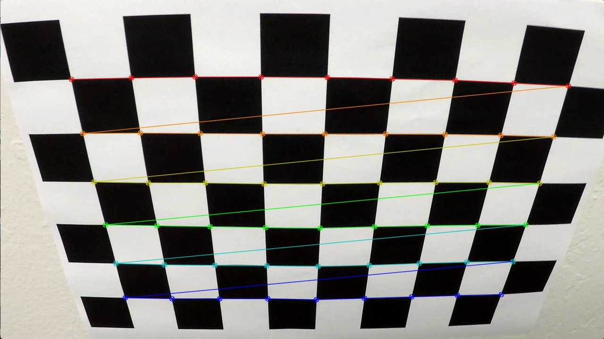
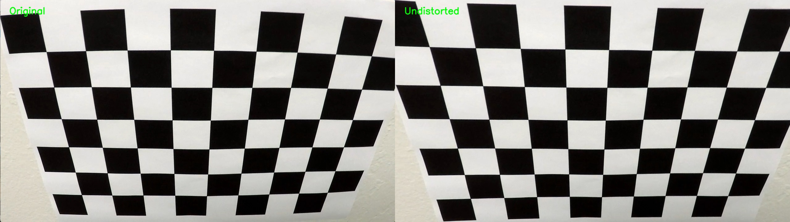
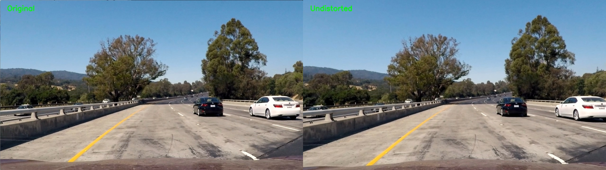
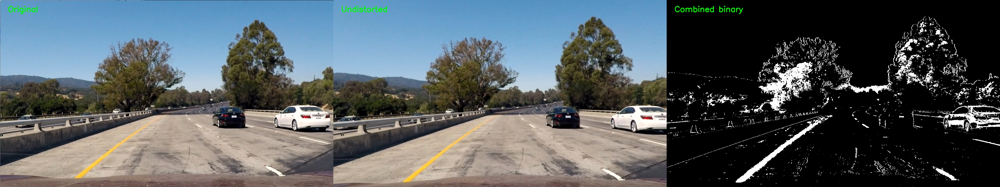
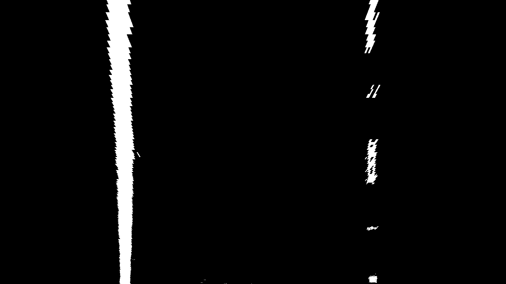
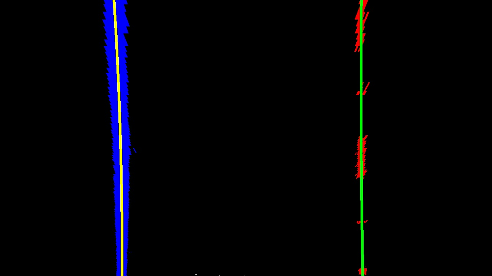
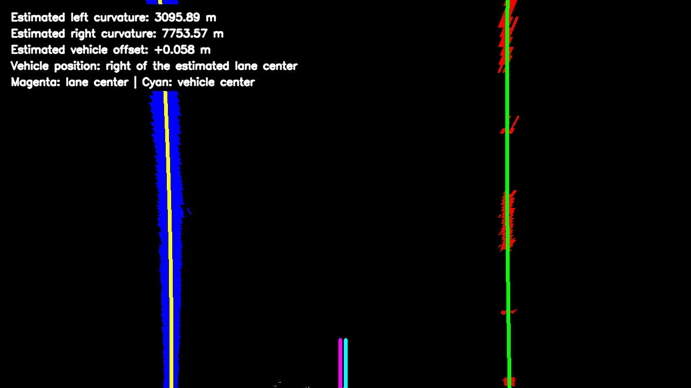
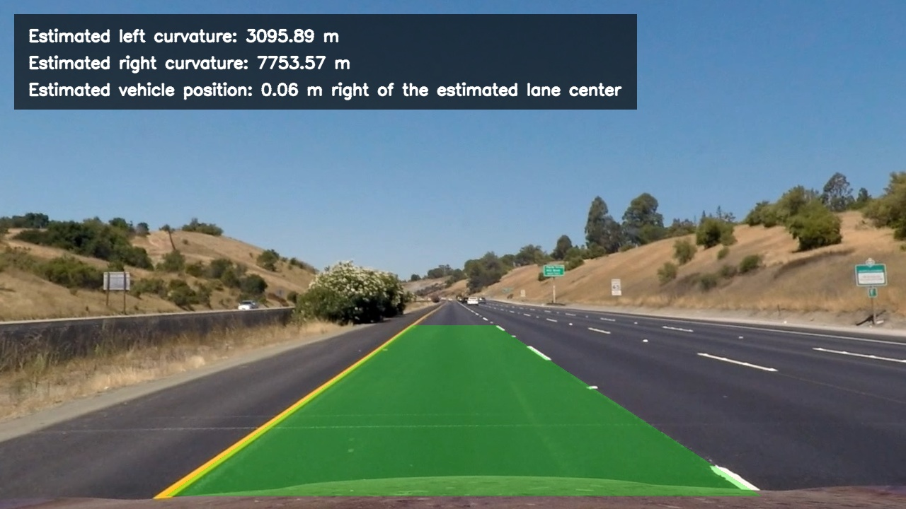
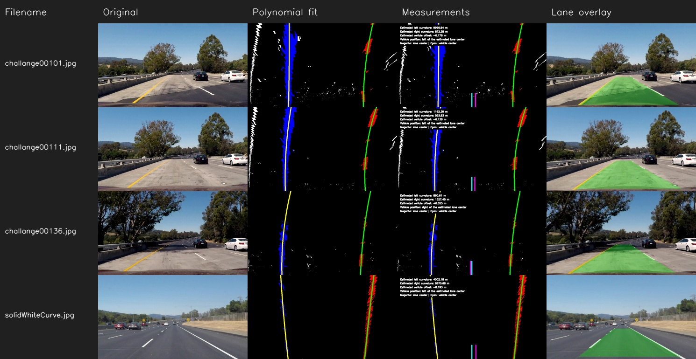

# Advanced Lane Finding Project

This project implements a complete computer-vision pipeline for detecting road-lane boundaries in images and video. The pipeline:

- calibrates the camera from chessboard photographs;
- corrects lens distortion;
- combines HLS color thresholds and a Sobel X gradient;
- transforms the road into a bird's-eye view;
- locates lane pixels and fits second-degree polynomials;
- estimates lane curvature and vehicle position;
- projects the detected lane area back onto the road;
- displays the lane, curvature, and vehicle offset on images and video.

I divided the implementation into small reusable modules so that I could inspect each stage separately and reuse the same functions in the complete image and video pipelines.

## Camera Calibration

### 1. Camera matrix and distortion coefficients

Camera calibration is implemented in `src/calibration.py`. The supplied chessboard contains 9 × 6 internal corners. For each calibration photograph, I convert the image to grayscale and use `cv2.findChessboardCorners()` to locate the pattern. I refine successful detections to sub-pixel accuracy with `cv2.cornerSubPix()` and pair them with planar object points whose `z` coordinate is zero.

The collected object/image-point correspondences are passed to `cv2.calibrateCamera()`. The resulting camera matrix, distortion coefficients, rotation and translation vectors, reprojection error, calibration resolution, pattern size, and successful image names are saved in `calibration_data/calibration.npz`.

I examined 20 calibration images and used 15 of them. Corner detection failed on `calibration1.jpg`, `calibration4.jpg`, and `calibration5.jpg`. I excluded `calibration7.jpg` and `calibration15.jpg` because their 1281 × 721 resolution differed from the 1280 × 720 calibration resolution.

The calculated camera matrix is:

```text
[[1.15877475e+03 0.00000000e+00 6.69642741e+02]
 [0.00000000e+00 1.15407661e+03 3.88079450e+02]
 [0.00000000e+00 0.00000000e+00 1.00000000e+00]]
```

The distortion coefficients are:

```text
[[-2.56779082e-01  4.33845159e-02 -6.87454487e-04
   1.25769022e-04 -1.15025457e-01]]
```

The RMS reprojection error is **0.852880 pixels**. I also inspected the detected corners manually and confirmed that they followed the internal chessboard intersections correctly.



`src/calibration.py` reuses `undistort_image()` from `src/undistort.py` to produce its correction example, ensuring that calibration and later pipeline stages use the same distortion-correction implementation.



## Pipeline (single images)

### 1. Distortion correction

Distortion correction is implemented in `src/undistort.py`. `load_calibration()` reads the saved camera matrix, distortion coefficients, and calibration resolution. `undistort_image()` then calls `cv2.undistort()` directly with the camera matrix and distortion coefficients.

For images at the calibration resolution, I use the saved intrinsic matrix unchanged. If an image has the same aspect ratio but was proportionally resized, `scale_camera_matrix()` adjusts `fx` and `cx` by the horizontal scale and `fy` and `cy` by the vertical scale. I scale the camera matrix for images with the same aspect ratio, assuming they were captured by the calibrated camera and only resized. This is not a substitute for calibrating a different camera.

Correcting distortion before detecting lanes prevents radial or tangential lens distortion from shifting the apparent positions of lane markings. Manual inspection of `test1.jpg` showed a natural corrected image, visible lane markings, and no obvious correction artifacts.



### 2. Color and gradient thresholding

Thresholding is implemented in `src/thresholding.py`. The undistorted BGR image is converted to HLS once and divided into hue, lightness, and saturation channels.

The white-lane mask selects:

- lightness: 200–255;
- saturation: 0–80.

The yellow-lane mask selects:

- hue: 15–35 in OpenCV's HLS representation;
- lightness: 30–255;
- saturation: 80–255.

I use the Sobel X operator on the HLS lightness channel with a kernel size of 3. Its absolute magnitude is scaled to 0–255 and thresholded from 20 to 100. I include gradient pixels only when their lightness is at least 120, which reduces responses from dark asphalt texture.

`combined_threshold()` joins the white, yellow, and bright-gradient masks and returns an array containing only 0 and 1. During testing, yellow and white lane markings remained visible, including curved and dashed sections. I also noticed responses from vegetation, vehicles, guardrails, and road texture, so the binary image is not a perfect separation of lane and background pixels. All 17 test photographs were processed successfully.



### 3. Perspective transformation

The perspective transform is implemented in `src/perspective.py`. The source trapezoid for a 1280 × 720 image is:

```text
top-left      (585, 460)
top-right     (705, 460)
bottom-right (1095, 700)
bottom-left   (240, 700)
```

I selected these points after comparing several experimental trapezoids. I tested bottom boundaries at y = 650, 700, and 719, and upper boundaries around y = 460, 440, and 425. The combination with y = 460 at the top and y = 700 at the bottom gave better road coverage without the poorer polynomial fits that appeared when the upper boundary was moved farther toward the horizon.

The destination is a rectangle with corners `(320, 0)`, `(960, 0)`, `(960, 719)`, and `(320, 719)`. Both point sets are stored as width/height ratios, allowing them to scale to proportionally resized inputs.

`cv2.getPerspectiveTransform()` calculates the forward matrix `M` and inverse matrix `Minv`. `cv2.warpPerspective()` transforms the 0/1 binary image using nearest-neighbor interpolation, preserving its binary values. `Minv` is retained for projecting the detected lane back onto the road.

The production pipeline does **not** apply a polygon ROI before this transform. I compared the baseline with broad, medium, and tight ROI masks. None of the masks reduced the five existing lane-width warnings or produced a consistent visual improvement, while the narrower masks could remove useful pixels from curved or dashed markings. For that reason, I kept the unmasked binary image.



### 4. Lane-pixel detection and polynomial fitting

Lane detection is implemented in `src/lane_detection.py`. A histogram counts nonzero pixels in each column of the lower half of the warped binary image. The strongest peaks in the left and right halves initialize a bottom-up search with nine sliding windows per boundary.

At 1280-pixel width, each window has a default horizontal margin of 70 pixels; the margin scales with image width. When a window contains enough pixels, its next position is recentered on their mean horizontal coordinate. This follows solid markings while also collecting separated sections of dashed markings.

The selected coordinates are independently fitted with:

```text
x(y) = Ay² + By + C
```

using `np.polyfit(y, x, 2)`. The implementation requires sufficient pixels and vertical coverage, and it reports an error if the fitted curves cross. I compared sliding-window margins of 70 and 100 pixels. The 70-pixel margin selected fewer unwanted pixels on `test1.jpg` and produced almost identical results on the other representative images, so I kept it as the default. A 100-pixel margin remains available through `--margin 100`. I also tested optional robust refinement, but it did not show a consistent improvement and is therefore not enabled by default.



The estimated distance `x_right(y) - x_left(y)` is sampled at several image heights as a diagnostic. With the final perspective configuration, relative sampled-width variations included **1.61%** for `straight_lines1.jpg`, **5.51%** for `straight_lines2.jpg`, **8.95%** for `test1.jpg`, and **11.47%** for `solidYellowCurve.jpg`. These values describe the fitted geometry in warped-image pixels; they are not physical lane-width measurements.

### 5. Radius of curvature and vehicle position

Metric estimates are implemented in `src/lane_measurements.py`. The calculation assumes a lane width of 3.7 m and a visible warped-road length of 30 m. The horizontal meter-per-pixel factor is obtained from the fitted lane width at the bottom of the image, while the vertical factor uses the warped-image height.

After refitting the detected points in meter coordinates, the radius of a second-degree curve is evaluated near the vehicle using:

```text
R = (1 + (2Ay + B)²)^(3/2) / |2A|
```

The vehicle center is the horizontal image center. The lane center is the midpoint between the two fitted boundaries at the bottom of the image. Their difference is converted to meters; the sign determines whether the vehicle is left or right of the estimated lane center.

Final estimated offsets included **0.058 m right** for `straight_lines1.jpg`, **0.031 m right** for `straight_lines2.jpg`, **0.101 m left** for `test1.jpg`, and **0.018 m left** for `solidYellowCurve.jpg`.



These values are estimates rather than ground-truth measurements. They depend on the assumed lane dimensions, threshold quality, polynomial fit, and perspective geometry, which explains why the independently calculated left and right curvature radii can differ noticeably.

### 6. Projecting the lane onto the road

`src/lane_overlay.py` evaluates the fitted boundaries for every row of the bird's-eye image and verifies that all coordinates are finite and that the left and right curves do not cross. `cv2.fillPoly()` fills the area between the two curves with green.

The filled polygon and its binary mask are projected into undistorted road coordinates using `Minv`. Blending is applied only where the projected mask is present: the result uses 70% of the undistorted road and 30% of the green layer, while pixels outside the lane remain unchanged.

`src/final_output.py` adds the estimated left and right curvature and vehicle offset to the overlay. Its complete batch mode processed all 17 test images without a failure. Representative straight, curved, and challenging results were visually inspected; the green area generally followed the detected lane boundaries and left the underlying road visible.



The complete-pipeline contact sheet below provides an additional overview of several inputs and intermediate results.



## Pipeline (video)

### 1. Final video output

Video processing is implemented in `src/process_video.py`. Each frame passes through the same undistortion, thresholding, perspective, measurement, and overlay functions used for still images.

I initialize the first valid frame with the full histogram and sliding-window search. For later frames, the tracker searches around the preceding valid polynomials, assigns overlapping pixels to the closer boundary, checks lane width and center movement, and smooths accepted coefficients over time. When a current detection is unreliable, it can briefly reuse the preceding valid fit and then try to reinitialize with sliding windows.

The default `project_video01.mp4` input has a resolution of 960 × 540 at 25 FPS. The current tracker and reinitialization logic processed all **221 frames**, and I visually inspected the generated result. I also reran `project_video02.mp4` and `project_video03.mp4` to check that the tracking changes had not broken the earlier results; both videos completed successfully.

[View or download the final processed project video](docs/project_video_output.mp4)

I also tested the pipeline on more difficult videos. Two representative results are included below:

- [Processed challenge video 01 with tracker reinitialization](docs/challenge01_reinitialized_output.mp4)
- [Processed challenge video 02 with tracker reinitialization](docs/challenge02_reinitialized_output.mp4)

All six final video results generated with the current tracker and reinitialization logic are also available in `output_video/`. This folder contains the three project videos and the three challenge videos, while the links above show the most important representative results.

The challenge videos showed the main limitation of this approach: fixed thresholds and fixed perspective geometry become less reliable with strong shadows, sharp bends, vehicles, and road layouts that differ from the test images. Temporal tracking recovers from many short detection failures, but the overlay can still move noticeably or temporarily reuse an older fit. I used these videos to identify the limitations of the method, while keeping the still-image pipeline unchanged.

## Discussion

### 1. Problems, limitations, and possible improvements

The most difficult part was separating lane markings from objects with similar colors or strong edges. The HLS thresholds retained saturated yellow and bright white pixels well, but road texture, guardrails, vegetation, vehicles, and shadows sometimes remained in the binary image. Sobel X provided useful edge information, although it also responded to some high-contrast background objects.

Choosing the perspective points required several comparisons. Extending the lower source points improved coverage near the vehicle, but moving the upper points farther toward the horizon made the polynomial fits less reliable. I therefore kept the top boundary at y = 460 and selected y = 700 for the bottom boundary. The points are stored proportionally, but one fixed transform cannot be metrically correct for every camera pose and road layout. This limitation appears in the lane-width variation and in differences between the left and right curvature estimates.

I tested several alternatives before selecting the final configuration:

- a 100-pixel sliding-window margin selected more unwanted pixels than the 70-pixel default on some images;
- robust residual filtering did not provide a clear visual improvement;
- a polygon mask before perspective transformation clipped useful lane pixels;
- broad, medium, and tight ROI masks did not consistently reduce width variation or improve final overlays;
- stricter experimental video tracking reduced responsiveness and failed earlier on a sharp challenge-video curve.

Based on these comparisons, I kept the simpler unmasked binary transform, the standard polynomial fit, and the existing video tracker. Possible improvements include adaptive thresholds, perspective points that adapt to the scene, a clearer confidence measure for each fit, a longer history of accepted video fits, and separate smoothing of the displayed measurements. Metric scale could also be improved by using verified real-world measurements and video from the same calibrated camera.

## Running the project

Create the environment from the repository root:

```bash
python3 -m venv .venv
source .venv/bin/activate
python -m pip install -r requirements.txt
```

Run individual stages:

```bash
python src/calibration.py
python src/undistort.py
python src/thresholding.py
python src/perspective.py
python src/lane_detection.py
python src/lane_measurements.py
python src/lane_overlay.py
python src/final_output.py
```

Process all test images through the complete still-image pipeline:

```bash
python src/process_full_pipeline.py
python src/final_output.py --all-images
```

Process the default project video:

```bash
python src/process_video.py
```

The original `writeup_template.md` is retained unchanged as the supplied project template. The final documentation is this `README.md`, and all images embedded above are stored in `docs/`.

## Project structure

```text
lane-finding/
├── camera_cal/                 # Chessboard calibration inputs
├── calibration_data/
│   └── calibration.npz         # Saved calibration parameters
├── docs/                       # README images and representative videos
├── output_images/              # Complete generated image results
├── output_video/               # Final reinitialized video results
├── src/
│   ├── calibration.py
│   ├── undistort.py
│   ├── thresholding.py
│   ├── perspective.py
│   ├── lane_detection.py
│   ├── lane_measurements.py
│   ├── lane_overlay.py
│   ├── final_output.py
│   ├── process_full_pipeline.py
│   └── process_video.py
├── test_images/
├── test_videos/
├── README.md
├── requirements.txt
└── writeup_template.md
```
